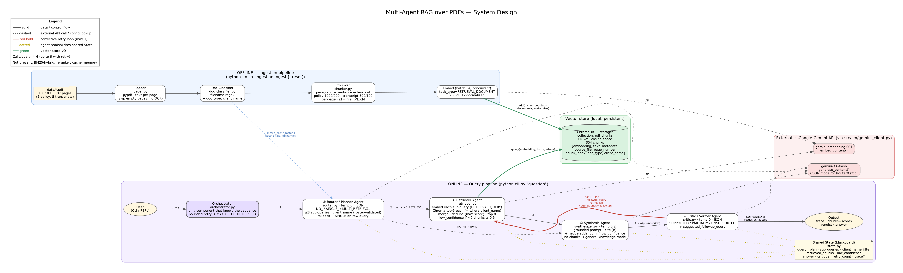
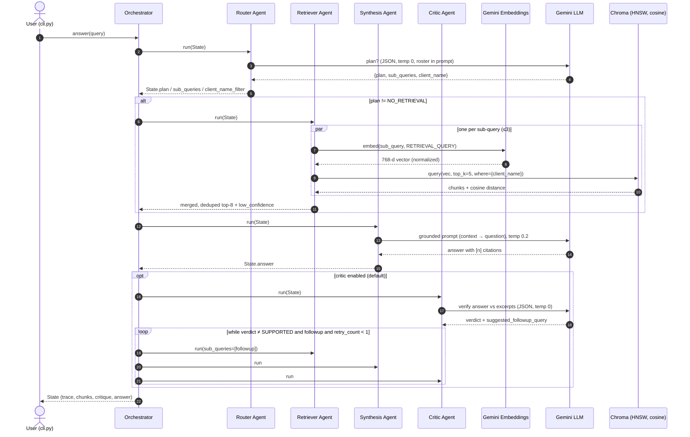
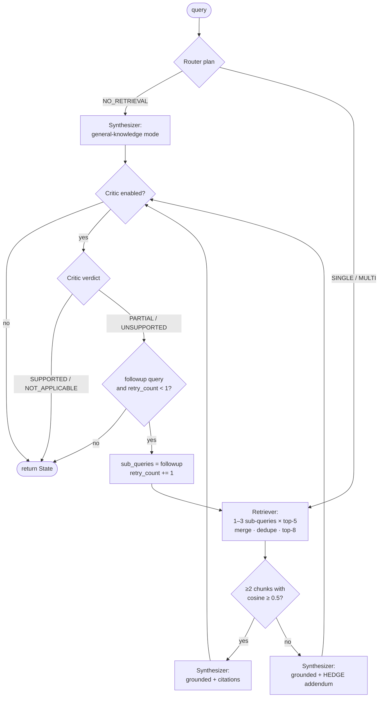
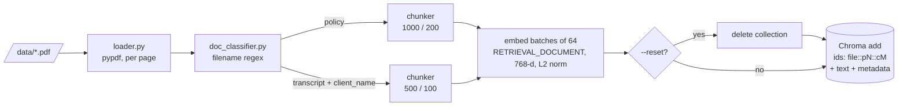
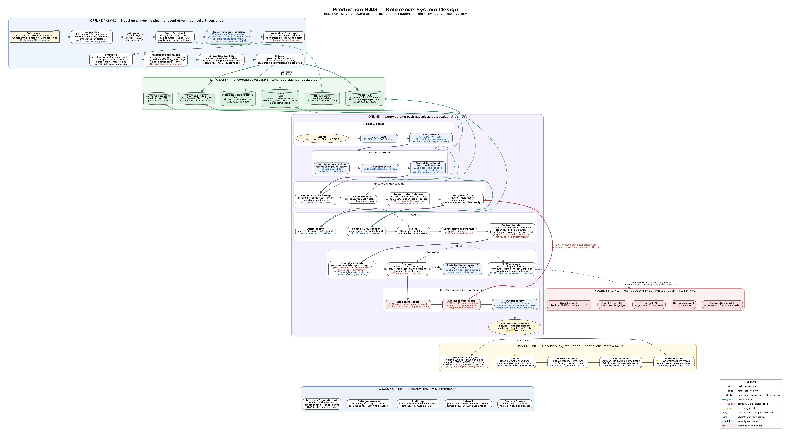

# System Design: Multi-Agent RAG over PDFs

| File | What it is |
|---|---|
| `architecture.png` / `architecture.svg` | Full system diagram: ingestion, vector store, agents, Gemini API, retry loop |
| `architecture.dot` | Graphviz source. Re-render with `dot -Tsvg architecture.dot -o architecture.svg && dot -Tpng -Gdpi=130 architecture.dot -o architecture.png` |
| `production_rag.png` / `production_rag.svg` / `production_rag.dot` | **Reference design for a production-grade RAG system**: ingestion, data layer, guarded serving path, hallucination controls `[H#]`, security controls `[S#]`, eval and observability. See §6. Re-render with `dot -Tsvg production_rag.dot -o production_rag.svg && dot -Tpng -Gdpi=130 production_rag.dot -o production_rag.png` |
| This file | Mermaid diagrams (render on GitHub or in VS Code): sequence diagram, decision flow, and a proposed hybrid BM25 design |



---

## 1. Query sequence (one question, end to end)



## 2. Orchestrator decision flow



## 3. Ingestion flow



Embedding runs **before** reset, so a failed API call leaves the existing index untouched.

---

## 4. Current vs. proposed retrieval (BM25 hybrid)

**Today the system uses dense-only retrieval. BM25 is not used.** Dense embeddings handle paraphrase well but miss exact tokens, and this corpus has plenty of them: standard numbers ("4.020"), dates ("5/21"), names, and acronyms. The proposed change keeps the agent contract and changes only the inside of `RetrieverAgent`.

```mermaid
flowchart LR
    SQ[sub-query] --> D[Dense: Gemini embed<br/>→ Chroma top-20]
    SQ --> B[Sparse: BM25<br/>rank_bm25 / SQLite FTS5<br/>top-20, same where-filter]
    D --> F[Reciprocal Rank Fusion<br/>score = Σ 1/(60 + rank)]
    B --> F
    F --> RR[Cross-encoder reranker<br/>optional]
    RR --> K[top-8 → Synthesizer]
```

| | Current | Proposed |
|---|---|---|
| Retrieval | Dense cosine only | Dense + BM25, fused with RRF |
| Fusion across sub-queries | Max raw cosine score (scores not comparable across queries) | RRF on ranks (scale-free) |
| Exact-match queries ("Standard 4.020", "5/21") | Weak | Strong |
| Extra infra | none | In-memory BM25 built at ingest (354 chunks → trivial) |
| Precision step | none | Optional reranker over the fused top 20–50 |

---

## 5. Key design properties (for discussion)

- **Blackboard pattern:** agents share only `State`. The `Orchestrator` alone owns the sequence, so agents are independently testable and swappable.
- **Fail toward retrieval:** if the router's output can't be parsed, the query falls back to `SINGLE_RETRIEVAL`. If the critic's output can't be parsed, the verdict becomes `PARTIALLY_SUPPORTED` and no retry happens.
- **Bounded self-correction:** at most 1 retry, so the worst case is about 9 API calls.
- **Citation-ready storage:** Chroma stores vector, text, and metadata together, so there's no side lookup.
- **Known gaps:** see `../PROJECT_WALKTHROUGH.md` §6. In short: `add()` doesn't overwrite existing chunks, a retry's new chunks can be dropped by the top-8 cut, the client filter excludes policy docs, and an empty retrieval falls back to general knowledge.

---

## 6. Production RAG reference design



This is the **target** architecture. It is not what this repo implements today; `architecture.png` shows the current system. Nodes carry tags: `[H#]` marks a hallucination-mitigation control and `[S#]` marks a security or privacy control. Both are listed below.

### Layers

| Layer | Components | Why it matters in production |
|---|---|---|
| Ingestion (async) | connectors (full + CDC), queue + DLQ, parse/OCR, security scan, dedupe, structure-aware chunking, metadata enrichment, embedding workers, indexer | Keeps the index fresh, idempotent and re-buildable. Deletes propagate. Embedding model version is pinned. |
| Data layer | vector DB, BM25 index, object store, metadata registry, Redis caches, conversation store | Hybrid retrieval, provenance for citations, per-tenant isolation, lineage. |
| ① Edge | CDN/WAF, API gateway | AuthN, rate limits, quotas, request caps |
| ② Input guardrails | identity → ACL filter, PII scrub, injection/jailbreak classifier | Stops abuse before it costs tokens or reaches data |
| ③ Query understanding | semantic cache, history condensation, intent router, query transform | Lower latency/cost. Handles chat follow-ups. Refuses out-of-scope queries early. |
| ④ Retrieval | dense + sparse → RRF → cross-encoder rerank → context builder | Recall (hybrid) followed by precision (rerank), within a token budget |
| ⑤ Generation | prompt registry, LLM gateway (routing, fallback, metering), structured cited output, optional tools | Reliability, cost control, auditable prompts |
| ⑥ Output guardrails | citation validator, groundedness check, output safety | Final check before the user sees anything |
| Cross-cutting | tracing, metrics, online + offline eval, feedback loop, secrets, network, audit, governance, red-team | Lets you measure, debug and prove safety |

### Hallucination mitigation (`[H#]`)

| Tag | Control | Where |
|---|---|---|
| H1 | Index only the latest doc version, so stale facts can't be retrieved | Normalize & dedupe |
| H2 | Provenance metadata (source URI, page, version) on every chunk | Metadata enrichment |
| H3 | Router refuses out-of-domain questions instead of answering from parametric memory | Intent router |
| H4 | Reranker relevance threshold drops weak chunks | Reranker |
| H5 | **Abstain path**: if too little evidence clears the threshold, reply "not found in your documents" instead of generating | Context builder |
| H6 | Grounding prompt: answer only from sources, cite `[n]`, allow "I don't know" | Prompt assembly |
| H7 | Low temperature + structured output where each claim carries citation ids | Generate |
| H8 | Citation validator: every claim cites a retrieved chunk, cited ids exist, quoted spans match the source | Output guardrails |
| H9 | Per-claim groundedness check (NLI model or LLM-judge). Below threshold → drop claim, regenerate or abstain | Output guardrails |
| H10 | Bounded corrective loop: unsupported claim → follow-up retrieval → regenerate (max 1–2) | ground → rewrite |
| H11 | Offline eval gate (faithfulness, citation accuracy, refusal correctness) blocks deploys that regress | CI |

Also relevant: hybrid retrieval and parent-chunk expansion improve recall, and missing context is the main cause of hallucination. Only grounded answers are written to the semantic cache, so a bad answer can't be replayed.

### Security & privacy (`[S#]`) — mapped to OWASP LLM Top 10 risks

| Tag | Control | Threat addressed |
|---|---|---|
| S1, S9, S12 | Capture source ACLs at ingest. Build the filter server-side from identity (never from client input). Apply it as a **pre-filter** in both dense and sparse search. | Cross-user / cross-tenant data leakage (sensitive information disclosure) |
| S2 | Connector creds read-only and scoped | Blast radius of a compromised ingestion job |
| S3 | Malware / file-type validation | Malicious uploads |
| S4, S10 | PII / secret detection at ingest and on queries; mask before LLM and logs | Privacy, PII in prompts, logs or provider retention |
| S5, S13 | Strip hidden text and instructions from docs; wrap retrieved text in delimiters as untrusted data | **Indirect prompt injection** via poisoned documents |
| S6–S8 | TLS, WAF, OIDC/JWT, rate limits, token quotas, size caps | Unauthorized access, denial-of-wallet, unbounded consumption |
| S11 | Injection / jailbreak classifier, topic moderation | Direct prompt injection |
| S14 | Provider no-train / zero-retention contract; self-host option | Data exfiltration to third parties |
| S15 | Tool allow-list, least privilege, human approval for writes | Excessive agency |
| S16 | Output PII/secret scan, system-prompt leak check, safe rendering (no HTML/JS, no auto-loaded links) | Improper output handling, markdown/image exfiltration |
| Cross-cutting | Vault/KMS, mTLS + egress allow-list, immutable audit log, retention + right-to-delete, pinned models/deps + SBOM, red-team suite | Supply chain, compliance (GDPR/SOC 2), forensics |

Cache keys include tenant + ACL hash, so the semantic cache can't serve one user's answer to another.

### What to measure

- **Retrieval:** recall@k, MRR, nDCG on a golden set
- **Generation:** faithfulness / groundedness, answer relevance, citation accuracy, abstain rate (both correct and incorrect refusals)
- **System:** p50/p95 latency per stage, cost per query, cache hit rate, error and fallback rate
- **Safety:** injection-suite pass rate, PII leak incidents, blocked-request rate

